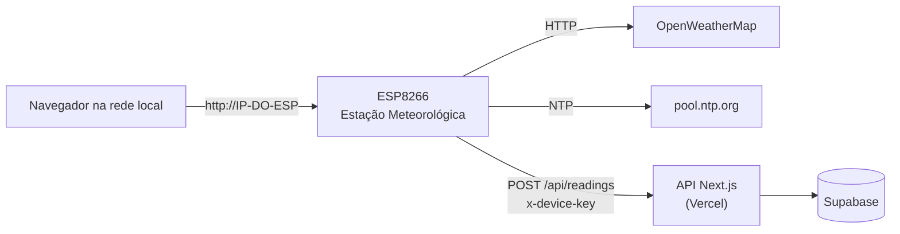

# 🌦️ Estação Meteorológica ESP8266

Estação meteorológica doméstica com **ESP8266**, display **OLED**, sensor de **temperatura e umidade interna**, clima e previsão do **OpenWeatherMap**, **página web** responsiva servida pelo próprio ESP, **configuração 100% pelo navegador**, leitura de **bateria**, **LED de status**, **OTA** e envio das leituras para uma **API/painel web** (Next.js + Vercel + Supabase).


> Projeto baseado no exemplo **WeatherStation** da biblioteca [ThingPulse ESP8266 Weather Station](https://github.com/ThingPulse/esp8266-weather-station) (MIT), bastante ampliado.

<!-- Adicione suas fotos e capturas de tela em docs/img/ e referencie aqui, por exemplo:


-->

---

## 📑 Sumário

1. [Recursos](#-recursos)
2. [Como funciona](#-como-funciona)
3. [Telas do display OLED](#-telas-do-display-oled)
4. [Página web local](#-página-web-local)
5. [Hardware](#-hardware)
6. [Ligações](#-ligações)
7. [Instalação do software](#-instalação-do-software)
8. [Primeira configuração](#-primeira-configuração)
9. [Página de configuração (`/config`)](#-página-de-configuração-config)
10. [Bateria](#-bateria)
11. [LED de status](#-led-de-status)
12. [Envio para o painel web (API)](#-envio-para-o-painel-web-api)
13. [Endpoints locais](#-endpoints-locais)
14. [Personalização no código](#-personalização-no-código)
15. [Segurança](#-segurança)
16. [Solução de problemas](#-solução-de-problemas)
17. [Estrutura do repositório](#-estrutura-do-repositório)
18. [Histórico de versões](#-histórico-de-versões)
19. [Ideias futuras](#-ideias-futuras)
20. [Créditos e licença](#-créditos-e-licença)

---

## ✨ Recursos

**Clima e sensores**
- Temperatura e umidade **internas** (DHT22/DHT11) com uma casa decimal.
- Clima **atual** e previsão de **3 dias** via OpenWeatherMap (temperatura, umidade, pressão, vento, visibilidade, nuvens, nascer e pôr do sol), consultados pelas **coordenadas da cidade**.
- **Próximas 24 h**: mínima e máxima reais, **chuva prevista** (mm) e **sensação térmica**, calculadas com os blocos de 3 h da previsão.
- **Sol e Lua** calculados no próprio ESP: nascer e pôr do sol e da Lua, fase da Lua e porcentagem iluminada.
- **Histórico** das últimas ~12 h de temperatura e umidade internas (um ponto a cada 5 min), com gráfico interativo na página web.

**Interface**
- Display OLED 0,96" com **7 telas** animadas, **escolhidas na página** (marque as que quer ver), e barra inferior com hora, indicadores das telas e temperatura externa.
- **Dois botões físicos**: um clique no primeiro passa para a próxima tela, e segurando por 8 s ele apaga só o WiFi salvo; o segundo botão **envia os dados ao painel** com um clique (mostrando o resultado no OLED) e faz o **reset geral** (apaga o WiFi e todos os ajustes) ao ser segurado por 10 s.
- **Tempo de cada tela** configurável na página (5 a 30 s, de 5 em 5).
- **Tempo de tela ligada** (sempre ligada, 1, 5, 10, 15, 30 ou 60 min): depois desse tempo a tela apaga sozinha para economizar bateria. Um clique no botão acende; no horário agendado como desligado, o clique acende a tela por 10 s.
- **Brilho da tela** ajustável (5% a 100%) e **brilho noturno**: à noite a tela pode apagar ou ficar acesa com brilho menor; quando acesa à noite, usa sempre o brilho noturno.
- **Placa UPS (nobreak)**: sensor opcional de **energia externa**. Um ícone de tomada, no OLED e na página, mostra se o ESP está ligado na tomada (5 V) ou rodando na bateria.
- **Página web responsiva** (celular e computador): clima, cartões, bússola de vento, anel de umidade, previsão, gráfico com eixos e seleção de ponto, ícones de configurações, tela, brilho, sinal WiFi e bateria.
- Tema escuro, sem dependência de internet para exibir a página (tudo embutido no ESP).

**Configuração sem editar código** (salva na flash/EEPROM)
- Chave da API, cidade e idioma do OpenWeatherMap.
- **Fuso horário** (34 opções) e horário de verão.
- **Ligar/apagar a tela** e **agenda automática** (ex.: apagar das 23:00 às 06:00).
- **Bateria** ativável por dispositivo (cada ESP pode ou não ter bateria).
- Dados do painel web: ID do dispositivo, URL da API e `DEVICE_KEY`.
- Portal de configuração de WiFi (WiFiManager), protegido por senha.
- Senhas, placa e padrões de fábrica num só arquivo, o `EstacaoConfig.h`.
- **Backup das configurações**: exporta todos os ajustes da `/config` num arquivo JSON e importa em outro ESP (ou no mesmo, depois de um reset geral), mantendo o ID do dispositivo de cada um.

**Conectividade e manutenção**
- Atualização **OTA** protegida por senha.
- **Funciona sem roteador**: se a rede cair (ou não estiver no ar ao ligar), a estação segue funcionando e reconecta sozinha.
- **Proteção contra CSRF**: outros sites abertos no navegador não conseguem mudar os ajustes da estação.
- **Senha na `/config`**, digitada uma vez por navegador (login lembrado por 30 dias). A página principal continua aberta para consulta.
- **LED azul de status**: conectando, sem WiFi, enviando dados, sucesso e falha.
- Envio periódico das leituras para uma **API REST** (a cada 15 min) e botão **"Enviar dados agora"**.
- Seção **Sistema** com memória, flash, motivo do último reinício, versão do firmware etc.

---

## 🧭 Como funciona



| Tarefa | Intervalo |
|---|---|
| Leitura do sensor interno | a cada 10 s |
| Clima atual e previsão (OpenWeatherMap) | a cada 15 min (nova tentativa em 1 min sem WiFi, em 5 min se a API falhar) |
| Ponto do histórico interno | a cada 5 min (144 pontos ≈ 12 h, ficam na RAM) |
| Leitura da bateria | a cada 30 s (média móvel) |
| Envio ao painel web (API) | a cada 15 min (1º envio 20 s após ligar; falhou, tenta de novo em 2 min) |
| Atualização dos números na página web | a cada 5 s (gráfico a cada 60 s) |

---

## 📟 Telas do display OLED

Ao ligar, o OLED mostra por 2,5 s (`ABERTURA_MS`) uma **tela de abertura** com o logo (sol atrás de uma nuvem), o nome "Estação Meteorológica" e a versão do firmware. O logo fica em `Logo_bits`, no `EstacaoImagens.h`.

Enquanto conecta ao WiFi, aparece "Conectando ao WiFi" com o ícone e **3 pontos animados**. Ao conectar, o OLED mostra por 4 s (`IP_TELA_MS`) a tela **WIFI CONECTADO**: faixa de título, ícone de sinal, nome da rede, sinal (dBm e %) e o **IP em destaque**. Se o ESP ligou sem rede, essa tela aparece na primeira vez que o WiFi conectar.

As telas deslizam automaticamente (padrão: **5 s** cada, ajustável de 5 a 30 s em `/config` → Display) e um clique no **botão físico** passa para a próxima a qualquer momento. A barra inferior mostra a hora (esquerda), os **indicadores das telas** (centro: ponto cheio = tela atual) e a temperatura externa (direita).

**Escolha das telas:** em `/config` → Display → "Telas do display", marque as que devem aparecer (pelo menos uma). Elas passam na ordem abaixo; com uma só, ela fica fixa. Vale na hora e fica salvo. O padrão de fábrica é `TELAS_PADRAO` (todas).

1. **Data e hora**
2. **Clima interno** (umidade e temperatura, uma casa decimal)
3. **Clima atual** (ícone, temperatura, cidade e descrição)
4. **Próximas 24 h** (mínima e máxima das próximas 24 h, umidade, sensação térmica, chuva prevista e vento)
5. **Próximos 3 dias**
6. **Sol e Lua** (veja abaixo)
7. **WiFi e bateria** (veja abaixo)

Tela "Sol e Lua", na ordem das linhas:

```
☀ ↑05:42  ↓18:31            nascer e pôr do sol
☾ ↑13:10  ↓01:22            nascer e pôr da Lua
 ◐   Quarto crescente       Lua desenhada com a fase
     Iluminada: 45%
```

Os horários são calculados no próprio ESP com as coordenadas da cidade, que chegam na primeira resposta do OpenWeatherMap (até lá aparecem `--:--`). A fase e a iluminação só precisam da data. No hemisfério sul, o lado iluminado da Lua é desenhado invertido, como se vê no céu.

Tela "WiFi e bateria", na ordem das linhas:

```
[▮▮▮▯] 85%  3.92V   🔌   1. bateria (ícone, percentual e tensão) e tomada (energia externa)
▂▄▆█   -62dBm  76%       2. sinal do WiFi (ícone de barras, dBm e %)
SSID: MinhaRede          3. nome da rede
IP: 192.168.0.50         4. IP (use no navegador)
```

Com a placa UPS ativada, a **tomada** aparece no canto direito da linha da bateria: **cheia** = energia externa conectada; **só contorno e riscada** = sem energia externa (rodando na bateria).

O ícone de sinal tem 4 barras: 75% ou mais enche as 4, 50% as 3, 25% as 2 e qualquer sinal acende 1. Sem WiFi, as barras ficam vazias e aparece "sem WiFi".

---

## 🌐 Página web local

Abra `http://IP-DO-ESP/` (o IP aparece na tela 6 do OLED).

**Barra superior:** engrenagem (abre a `/config`), botão de **ligar/apagar a tela** (com risca vermelha quando apagada), **brilho da tela** (sol com o percentual que vale agora; amarelo = brilho de dia, lilás = brilho noturno, esmaecido com a tela apagada), **sinal de WiFi** (4 barras, com dBm e % ao passar o mouse), **tomada** (verde = energia externa conectada; riscada = rodando na bateria; só se o sensor estiver ativado) e **bateria** (ícone com percentual, só se ativada). Com energia externa conectada, o aviso de bateria baixa não aparece.

**Avisos:** faixa amarela de bateria baixa (≤ 20%), vermelha de bateria crítica (≤ 10%) e aviso quando não for possível obter o clima.

**Conteúdo:** clima atual com a mínima e a máxima das próximas 24 h, umidade, pressão, vento (com bússola), visibilidade, nuvens, nascer e pôr do sol, sensação térmica, chuva prevista nas 24 h, Lua (fase, iluminação, nascer e pôr), clima interno (com anel de umidade), previsão dos próximos dias e **histórico interno** com eixos (temperatura à esquerda, umidade à direita), horários e leitura exata do ponto ao passar o mouse ou arrastar o dedo.

**Rodapé:** horário da última atualização e dados do WiFi (`WiFi -62 dBm (76%)`).

---

## 🧰 Hardware

**Lista de materiais**

| Item | Observação |
|---|---|
| ESP8266 (NodeMCU / ESP-12E) | Modelo comum **ou** NodeMCU com OLED integrado |
| Display OLED 0,96" I2C | SSD1306 ou SSD1315 (compatível), endereço `0x3C` |
| Sensor **DHT22** (recomendado) ou DHT11 | Mesma biblioteca; o DHT22 é mais preciso e mede abaixo de 0 °C |
| Resistor 10 kΩ | Só se o DHT for o de 4 pinos solto (pull-up no dado) |
| *(opcional)* Bateria Li-ion 18650 | Com módulo de carga/proteção (ex.: TP4056 com proteção) |
| *(opcional)* Resistor 100 kΩ | Divisor para ler a bateria no A0 |
| 2 botões de pressão (normalmente abertos) | Um passa as telas e apaga o WiFi; o outro faz o reset geral |
| *(opcional)* Placa UPS (módulo carregador + elevador 5 V para Li-ion) | Funciona como nobreak |
| *(opcional)* Resistores 10 kΩ e 20 kΩ | Divisor de tensão do sensor de energia |
| Jumpers e protoboard | |

---

## 🔌 Ligações

### Variante A: ESP8266 comum + OLED externo (padrão do código)

| Componente | Pino do ESP8266 |
|---|---|
| OLED SDA | **D2** (GPIO4) |
| OLED SCL | **D1** (GPIO5) |
| OLED VCC / GND | 3V3 / GND |
| DHT22 dado | **D5** (GPIO14) |
| DHT22 VCC / GND | 3V3 / GND |
| Bateria (via divisor) | **A0** |
| Sensor de energia (placa UPS, via divisor) | **D0** (GPIO16) |
| LED azul (status) | interno (GPIO2 = D4; em algumas NodeMCU também GPIO16 = D0) |
| Botão das telas / apagar WiFi | **D7** (GPIO13) → GND |
| Botão de reset geral | **D6** (GPIO12) → GND (na variante B use o **D1**) |

**Por que D1/D2 no display:** são os pinos I2C padrão e não têm função especial no boot. Evite **D3 (GPIO0), D4 (GPIO2) e D8 (GPIO15)**, que são pinos de boot, e lembre que o D4 é o LED.

### Variante B: NodeMCU com OLED integrado

O OLED já vem soldado em **D5 (SDA)** e **D6 (SCL)** neste modelo (confirmado na prática; algumas fichas de venda trazem esses números trocados).

| Componente | Pino |
|---|---|
| OLED SDA / SCL | **D5 / D6** (já soldados na placa) |
| DHT22 dado | **D2** (GPIO4) |
| Botão das telas | **D7** → GND |
| Botão de reset geral | **D1** → GND (o D6 é o SCL do display) |

Para usar essa placa, **troque uma única linha** no `EstacaoConfig.h` (seção 2, "Seleção da placa e pinagem"):

```cpp
//#define PLACA_ESP8266_COMUM          // comente esta
#define PLACA_OLED_INTEGRADO           // e descomente esta
```

Os pinos do display, do sensor e dos botões mudam sozinhos. Se a tela ficar em branco, troque `DISPLAY_SDA` e `DISPLAY_SCL` entre si no bloco dessa placa.

### Sensor DHT11 em vez de DHT22

No bloco da sua placa (seção 2 do `EstacaoConfig.h`), troque apenas o número do modelo (a biblioteca é a mesma). Aceita 11, 12, 21 ou 22; outro valor dá erro de compilação:

```cpp
#define SENSOR_TIPO      11           // 11 = DHT11, 12 = DHT12, 21 = DHT21, 22 = DHT22 (AM2302)
```

O modelo é um número, e não `DHT11`/`DHT22`, porque na biblioteca DHT esses nomes são constantes de C++: o `#if` do pré-processador não as enxerga e trataria todos os modelos como iguais (o nome do sensor ficava sempre "DHT11" nas mensagens).

O DHT11 mede em passos inteiros (a casa decimal ficará sempre zero), com precisão menor e só de 0 a 50 °C.

### Botões físicos

Ligue cada botão de pressão **entre o pino e o GND**. Não precisa de resistor: o código usa o pull-up interno.

| Botão | Pino padrão | Ação | O que acontece |
|---|---|---|---|
| **Das telas** | **D7** (GPIO13) | Clique | Próxima tela do OLED. Com a tela apagada, o clique só liga a tela |
| | | Segurar 3 s | Aparece "Apagando o WiFi..." com barra de progresso e o LED pisca rápido. Soltar cancela |
| | | Segurar 8 s | Apaga **só a rede WiFi salva** e reinicia. Na volta, abre o portal `EstacaoMeteorologica` |
| **Reset geral / envio** | **D6** (GPIO12); na variante B, **D1** | Clique | **Envia uma leitura ao painel agora** (igual ao botão "Enviar dados agora" da `/config`). Durante o envio, o OLED mostra uma tela "PAINEL WEB" com uma nuvem com seta, a etapa atual ("Preparando dados", "Conectando (HTTPS)") e uma barra de progresso. No fim, por 3,5 s: **sucesso** = círculo com visto, "Enviado!", o **código HTTP**, o tempo do envio e a leitura enviada (ex.: `HTTP 200  1,2 s` / `24.5°C  61%`); **falha** = círculo com X, "Falhou", o erro e quando será a nova tentativa. Se a tela estiver apagada, ela acende só para mostrar o resultado |
| | | Segurar 3 s | Aparece "RESET GERAL - Apaga WiFi e ajustes" com barra de progresso e o LED pisca rápido. Soltar cancela |
| | | Segurar 10 s | Apaga o **WiFi e todos os ajustes salvos** (chave do OpenWeatherMap, cidade, idioma, fuso, agenda, bateria, ID/URL/`DEVICE_KEY` do painel e tempo das telas) e reinicia no padrão do código |

O clique rápido no segundo botão **só envia os dados**; para o reset é preciso segurar por 10 s, com aviso na tela, e soltar antes cancela. Se não quiser esse botão, defina `PIN_BOTAO_RESET` como `-1`; o botão das telas continua apagando o WiFi ao ser segurado.

Evite D0, D3, D4 e D8 (pinos de boot e LED) e os pinos do display e do sensor.

> A leitura dos botões acontece no laço principal. Cliques durante o envio à API ou a atualização do clima (alguns segundos) podem ser perdidos.

### Sensor de energia (placa UPS)

Com uma placa UPS (carregador + elevador 5 V para Li-ion) o ESP funciona como um nobreak. Para saber se há energia externa, o **D0 (GPIO16)** lê se existe 5 V na **entrada** da UPS, por um divisor de tensão:

```
Entrada 5 V da UPS (IN+, do carregador/USB) ──[ 10 kΩ ]───┬── D0 (GPIO16)
                                                          │
                                                       [ 20 kΩ ]
                                                          │
GND (comum com o ESP) ────────────────────────────────────┘
```

- O divisor reduz 5 V para cerca de 3,3 V, que o pino aguenta. **Nunca ligue os 5 V direto no pino.**
- Meça a **entrada** da UPS (IN+), não a saída: a saída tem 5 V também quando roda na bateria.
- O GND da UPS e o do ESP precisam ser o mesmo.
- Ative em `/config` → **Bateria e energia** → "Placa UPS". Desmarcado, o ícone não aparece (útil para ESPs sem UPS).
- Se o ícone estiver invertido (sensor com lógica contrária), troque `ENERGIA_ATIVA_EM_ALTO` para `false`.
- Com o D0 usado como sensor, o **segundo LED do D0** (que algumas NodeMCU têm) deixa de ser usado no LED de status. O LED do módulo, no D4, continua. Se a sua placa tem LED no D0 e ele ficar levemente aceso, use `PIN_ENERGIA = -1` ou o pino de outra placa.

### Bateria no A0

O ADC do ESP8266 lê só de **0 a 1 V**. As placas NodeMCU têm um divisor interno de 220 kΩ / 100 kΩ (entrada de até ~3,2 V). Para medir uma Li-ion (até 4,2 V), coloque **100 kΩ em série**:

```
Bateria (+) ──[ 100 kΩ ]── A0
Bateria (−) ────────────── GND
```

Fator total do divisor = (100k + 220k + 100k) / 100k = **4,2** (`BAT_FATOR`). Sem divisor interno na placa, use R2 = 100 kΩ e R1 = (fator − 1) × R2.

> ⚠️ **Nunca ligue uma Li-ion de 4,2 V direto no pino 3V3**: o ESP8266 aceita no máximo cerca de 3,6 V. Alimente por uma entrada com regulador e use módulo de carga com proteção.

---

## 💻 Instalação do software

### 1. Arduino IDE e placa
1. Instale a [Arduino IDE](https://www.arduino.cc/en/software).
2. Em **Preferências → URLs adicionais**, inclua:
   `http://arduino.esp8266.com/stable/package_esp8266com_index.json`
3. Em **Gerenciador de Placas**, instale **esp8266** (pacote da comunidade ESP8266).
4. Selecione a placa **NodeMCU 1.0 (ESP-12E Module)**.

### 2. Bibliotecas (Gerenciador de Bibliotecas)

| Biblioteca | Autor |
|---|---|
| **ESP8266 Weather Station** | ThingPulse / Daniel Eichhorn |
| **JSON Streaming Parser** | Daniel Eichhorn |
| **ESP8266 and ESP32 OLED driver for SSD1306 displays** | ThingPulse |
| **WiFiManager** (série 2.x) | tzapu |
| **DHT sensor library** (+ **Adafruit Unified Sensor**) | Adafruit |

Já fazem parte do pacote ESP8266: `ESP8266WiFi`, `ESP8266WebServer`, `ArduinoOTA`, `EEPROM`, `Ticker`, `ESP8266HTTPClient` e `WiFiClientSecure`.

### 3. Gravar
1. Coloque **todos os `.ino`** (o `EstacaoMeteorologica.ino` e as abas `Backup`, `Clima`, `Config`, `Painel`, `Placa`, `Tela`, `Web`, `WebAcoes` e `WebConfig`), o `EstacaoConfig.h`, o `EstacaoFontes.h` e o `EstacaoImagens.h` **na mesma pasta chamada `EstacaoMeteorologica`**. A IDE abre as abas sozinha. Se você baixou o projeto e não tem o `EstacaoConfig.h`, copie o `EstacaoConfig.example.h` com esse nome.
2. Abra o `EstacaoConfig.h` e troque as senhas (`OTA_SENHA`, `PORTAL_SENHA` e `CONFIG_SENHA`). Se precisar, escolha a placa na seção 2.
3. Conecte o ESP por USB, escolha a porta e clique em **Carregar**.
4. Nos envios seguintes, a placa também aparece como **porta de rede** (OTA). A IDE pede a senha `OTA_SENHA`.

---

## 🚀 Primeira configuração

1. **Ligue o ESP.** Sem WiFi salvo, ele cria a rede **`EstacaoMeteorologica`** (`PORTAL_SSID`), protegida pela senha `PORTAL_SENHA` do `EstacaoConfig.h`, e o LED pisca rápido. O OLED mostra **CONFIGURAR O WIFI** com o nome da rede, a senha e o endereço do portal (`192.168.4.1`). Com uma senha de mais de uns 13 caracteres, a linha aparece sem o "Senha:" na frente; acima de uns 20, ela sai cortada na tela.
2. Conecte-se a ela pelo celular, usando essa senha. O portal abre sozinho (ou acesse `192.168.4.1`). Escolha a sua rede e informe a senha.
3. O ESP reinicia e conecta. O **IP** aparece na tela "WIFI CONECTADO" logo depois de conectar e na tela "WiFi e bateria" do OLED (ou na lista de clientes do roteador).
4. Abra `http://IP-DO-ESP/` no navegador e toque na **engrenagem** para abrir a `/config`.
5. Em **Cidade e clima**, informe a **chave da API do OpenWeatherMap** e clique em **Salvar e atualizar**. Depois escolha a **cidade**: digite o nome em "Buscar cidade pelo nome" (ex.: `Campinas, BR`), clique em **Buscar**, escolha o resultado (preenche a latitude e a longitude), ajuste o **idioma** e salve de novo. O **fuso** fica em **Data e hora**.
6. Pronto. Se quiser enviar para o painel, preencha também **Painel web (API)** (veja [mais abaixo](#-envio-para-o-painel-web-api)).

**Sem roteador ao ligar:** com uma rede já salva, o ESP espera a conexão por até 30 s (`WIFI_BOOT_TIMEOUT_MS`). Se não conseguir, mostra "Sem WiFi - Seguindo sem rede" e continua funcionando (sensor, display, botões e histórico). Ele reconecta sozinho quando o roteador voltar e atualiza o clima na hora. O portal só abre automaticamente quando não há rede salva.

**Trocar de rede depois:** segure o botão das telas por 8 s (apaga o WiFi salvo e abre o portal) ou use `/config` → **WiFi** → "Apagar dados de WiFi". Para voltar tudo ao padrão de fábrica, segure o botão de reset geral por 10 s.

**OpenWeatherMap:** crie a conta e a chave em <https://home.openweathermap.org/api_keys> (chaves novas podem levar um tempo para ativar). 

**Cidade (`/config` → Cidade e clima):** há três jeitos, todos na mesma tela:
- **Buscar pelo nome** (mais fácil): digite `Cidade, BR` ou `Cidade, UF, BR` e escolha entre até 5 resultados. A busca usa a API de geocodificação do OpenWeatherMap, gratuita e com a mesma chave (salve a chave antes). Escolher um resultado preenche a latitude e a longitude e limpa o ID.
- **Latitude e longitude**: digite as duas, ou cole `latitude, longitude` (como o Google Maps copia) no campo da latitude.
- **ID da cidade** (opcional): busque em <https://openweathermap.org/find> e copie o número no fim do endereço (`.../city/3448439`); pode colar o endereço inteiro.

A regra: com a latitude e a longitude preenchidas, valem elas (o ID, se houver, só vai para o painel como `city_id`). Só com o ID, a estação descobre as coordenadas na primeira consulta e os campos aparecem preenchidos depois. Sem nenhum dos dois, a página recusa. Sem ID, o `city_id` vai ao painel como `null`.

> 💡 O padrão do código é fuso `-3` (Brasília), sem horário de verão, idioma `pt_br`.

---

## 🔧 Página de configuração (`/config`)

A página segue o estilo dos **Ajustes do iPhone**. Ela abre num **menu** com uma linha por seção: ícone colorido, nome e um **resumo do estado** (por exemplo, "Campinas · chave salva" ou "Ligado · brilho 80% · 6 telas"). Tocando numa linha, abre a página só daquela seção (`/config?s=...`), com os campos agrupados em **cartões**. "‹ Configurações" volta ao menu.

- **Listas e chaves liga/desliga salvam ao tocar**, sem botão (brilho, tempo das telas, fuso, LED, bateria). Formulários com texto (cidade, painel) e listas longas (telas, horário automático) têm botão de salvar.
- **Itens longos abrem na própria página** (linha com ›): "Telas do display" e "Horário automático".
- A mensagem de salvo ou de erro aparece no topo da seção.
- Cada seção é uma página pequena, enviada em partes, e o estilo fica guardado na flash: o ESP usa menos RAM para montar cada página.

| Seção | O que tem |
|---|---|
| **Cidade e clima** | Estado do clima e coordenadas, chave da API, **busca da cidade pelo nome**, latitude e longitude, ID da cidade (opcional) e idioma (7 opções) |
| **Display** | Tela ligada, brilho de agora, **telas do display**, **horário automático**, tempo de cada tela, apagar sozinha após, **brilho** de dia e de noite, quando a noite começa (horário automático ou pôr do sol) e o que fazer no horário de apagar |
| **Data e hora** | Hora atual, **fuso horário** (34 opções), horário de verão e os servidores NTP |
| **Bateria e energia** | Bateria no A0 e placa UPS (por dispositivo); estado: alimentação, carga, tensão e situação |
| **Painel web** | Último envio, envio automático, cidade enviada, **Enviar dados agora** e os dados do painel (ID do dispositivo, URL da API e `DEVICE_KEY`) |
| **WiFi** | Dados da conexão com ícone de sinal, abrir o portal de configuração e apagar a rede salva |
| **LED de status** | Piscar para indicar o estado e seguir o horário da tela |
| **Sistema** | Em 4 grupos: **Funcionamento** (tempo ligado, último reinício, hora, servidores NTP, sensor, coordenadas com link para o mapa), **Memória** (barras coloridas de programa, memória livre, maior bloco e fragmentação), **Hardware** (chip, CPU, flash) e **Software** (firmware, core, SDK). Botão **Copiar diagnóstico**, **Desconectar todos os navegadores** (login), **Exportar e Importar configurações** (backup), **Reiniciar o ESP** e **Reset geral** (apaga WiFi e todos os ajustes, com confirmação) |

Todas as páginas pedem login (`CONFIG_SENHA`). O botão **Sair** fica no fim do menu.

Tudo é gravado na EEPROM e sobrevive a reinicializações e a novos uploads (só uma limpeza total da flash apaga). Campos de chave aceitam deixar em branco para **manter o valor atual**; só os 4 últimos caracteres aparecem.

**Brilho:** o brilho da tela vale durante o dia. O **brilho noturno** vale no horário de tela desligada do horário automático, e você escolhe o que acontece nesse horário:
- **Apagar a tela** (padrão): a tela apaga como antes. Se você acender nesse horário (clique no botão, mensagem de envio ou botão da página), ela acende **com o brilho noturno**.
- **Manter acesa com o brilho noturno**: no horário de apagar, a tela só diminui o brilho. O tempo de tela ligada continua valendo.

Em "O brilho noturno vale" você escolhe o que é a noite:
- **No horário de tela desligada do horário automático** (padrão): como descrito acima. Sem o horário automático ativado, vale sempre o brilho do dia.
- **Do pôr ao nascer do sol**: o brilho noturno vale enquanto o sol está abaixo do horizonte, calculado com as coordenadas da cidade, sem configurar horário. A página mostra os horários de hoje. "Apagar a tela" continua seguindo o horário automático.

O controlador do OLED tem uma faixa de brilho limitada: mesmo em 5% a tela continua legível, mas a diferença para 100% é clara num ambiente escuro.

**Agenda da tela:** o botão manual vale até o próximo horário programado. A agenda depende da hora da internet (NTP), então só age depois de sincronizar.

### Registro de eventos

Em `/config` → **Registro** aparecem os últimos eventos da estação, com a hora, os mais novos em cima, como no log de um roteador:

```
14:32:05   OK     Painel: HTTP 200 (1.6 s)
14:30:00   INFO   Clima: São Paulo, 24 °C
14:10:44   ERRO   WiFi caiu
14:02:11   INFO   WiFi: MinhaRede · 192.168.12.2
+00:00:00  INFO   Ligado (v3.9.0): Software/System restart
```

- Entram só os **eventos**: ligar (com o motivo do reinício), WiFi conectado, caiu ou voltou, clima atualizado ou com falha, envio ao painel (código HTTP e tempo), energia externa caiu ou voltou, bateria baixa, crítica ou normal de novo, falha e volta do sensor, login certo ou errado (com o IP), ajustes salvos ou recusados, tela ligada ou apagada pela página e OTA. O monitor serial pela USB continua com todas as mensagens.
- Cada evento tem uma etiqueta colorida: **OK** (verde: envio com HTTP 2xx, algo que voltou, login, ajuste salvo), **INFO** (cinza), **AVISO** (amarelo: bateria baixa, rodando na bateria, falta a chave ou a cidade, reinício depois de travar) e **ERRO** (vermelho: falhas, WiFi caiu, senha errada, ajuste recusado, bateria crítica). A lista fica numa caixa no estilo console, com rolagem própria.
- Antes de a hora da internet chegar, a hora aparece como tempo desde que ligou (`+00:00:04`).
- A página se atualiza a cada 2 s. **Pausar** congela a lista, **Baixar .txt** salva o que está na tela e **Limpar** apaga o registro.
- Fica na RAM: com `LOG_BYTES 1024` (padrão) cabem 21 eventos, e os mais antigos saem quando enche. Ao reiniciar, começa vazio. `LOG_BYTES 2048` guarda 42 eventos, mas tira mais 1 KB do heap livre (confira a memória em Sistema; o HTTPS precisa de 12,5 KB livres).
- `#define LOG_WEB 0` no `EstacaoConfig.h` desliga o registro: o item some do menu e não ocupa RAM nem flash.
### Backup das configurações

Em `/config` → Sistema → **Backup das configurações**:

- **Exportar configurações** baixa o arquivo `estacao-<chip>.json` com todos os ajustes: cidade (ID e coordenadas), chave do OpenWeatherMap, idioma, fuso e horário de verão, telas do OLED, tempo de cada tela, tempo de tela ligada, brilho e brilho noturno, agenda, bateria, sensor de energia, economia na bateria, LED de status, URL do painel e `DEVICE_KEY`.
- **Importar configurações** abre a escolha do arquivo. O navegador confere se é um backup da estação e pede confirmação; o ESP aplica cada campo com as mesmas regras da `/config`, grava, mostra quantos ajustes aplicou (e quais ignorou, se algum valor estiver fora da faixa) e reinicia.
- **ID do dispositivo:** nunca vai no arquivo. Ao importar, cada ESP mantém o ID dele (o salvo em Painel web ou o padrão `esp8266-<chip>`), para o painel não misturar as leituras de dois ESPs.
- **O que fica de fora:** o WiFi (fica com o WiFiManager), as senhas do `EstacaoConfig.h` e o login dos navegadores.
- **Campos ausentes** no arquivo, e chaves em branco, mantêm o valor atual do ESP. Uma URL do painel em branco desliga o envio, como na `/config`.

O arquivo é um JSON simples, de um nível, que pode ser lido e editado num editor de texto:

```json
{"formato":1,"firmware":"3.6","chip":"a1b2c3","owmChave":"...","cidadeId":"3463011","lat":-20.53860,"lon":-47.40080,
 "idioma":"pt_br","fuso":-180,"verao":false,"telaLigada":true,"telas":127,"telaSeg":10,"telaMin":0,"brilho":80,
 "brilhoNoite":20,"noiteDiminui":true,"noitePeloSol":false,"agenda":true,"agendaLiga":"07:00","agendaDesliga":"23:00",
 "bateria":true,"energia":true,"eco":true,"ecoIntervalo":30,"led":true,"ledAgenda":true,
 "painelUrl":"https://SEU-APP.vercel.app/api/readings","painelChave":"..."}
```

---

## 🔋 Bateria

Ative em **`/config` → Bateria e energia**. A leitura usa média móvel (90% do valor anterior + 10% do novo) a cada 30 s, então reage devagar de propósito.

**Calibração:** compare a tensão mostrada com a de um multímetro e ajuste no código:

```cpp
const float BAT_FATOR  = 4.2f;          // divisor de tensão (veja Ligações)
const float BAT_CALIB  = 0.99947619f;   // tensão do multímetro ÷ tensão lida (calibre a sua)
```

**Curva de carga** (interpolação linear entre os pontos, ajustada com multímetro):

| Tensão (V) | 4,20 | 4,15 | 4,10 | 4,015 | 3,93 | 3,84 | 3,755 | 3,68 | 3,61 | 3,48 | 3,29 | 3,00 |
|---|---|---|---|---|---|---|---|---|---|---|---|---|
| Carga (%) | 100 | 95 | 90 | 80 | 70 | 60 | 50 | 40 | 30 | 20 | 10 | 0 |

Os pontos ficam no vetor `V[]`/`P[]` da função `bateriaPercentual()`. Os avisos usam `BAT_AVISO_PCT` (20%) e `BAT_CRITICA_PCT` (10%).

O percentual é uma **estimativa pela tensão**: cai sob carga e varia com a temperatura e o desgaste da célula. A seção Bateria e energia também mostra a **situação** por faixa de tensão (de "Totalmente carregada" a "Descarga profunda").

> Com o OLED aceso e o WiFi sempre ligado, o ESP8266 consome algo como 80 a 150 mA. Uma 18650 dura em torno de um dia. Para longa duração seria necessário *deep sleep*, o que desliga a página web e o display.

### Economia na bateria

Em **`/config` → Bateria e energia → Economia na bateria** (precisa da **placa UPS** ativa, que informa quando falta energia externa):

- **Sem energia externa**, o WiFi entra em ***light sleep***: dorme entre os sinais do roteador e continua conectado. O consumo do ESP cai de ~15–20 mA para ~1–3 mA em repouso (valores típicos; o regulador e o chip USB da placa e o OLED aceso gastam à parte).
- **Envio ao painel** na bateria a cada 15, 20, **30**, 45 ou 60 min (escolhido na mesma seção).
- **Abrir a página ou apertar um botão** deixa o ESP acordado por `ECO_ACORDADO_MS` (2 min): só o primeiro acesso demora até ~0,3 s a mais. O envio ao painel, a consulta do clima e o **OTA** também rodam sem o sono.
- **Na tomada nada muda**: o WiFi volta na hora ao modo normal (*modem sleep*).

Com a tela apagada e o ESP dormindo, o `loop()` faz pausas de `ECO_LOOP_MS` (100 ms); um toque muito rápido no botão pode precisar ser um pouco mais longo. Os padrões ficam no `EstacaoConfig.h` (`ECO_BATERIA_PADRAO`, `ECO_INTERVALO_PADRAO`, `ECO_ACORDADO_MS`, `ECO_LOOP_MS`).

---

## 💡 LED de status

O LED azul (GPIO2 e, se o D0 não for o sensor de energia, também o GPIO16) indica o estado sem travar o programa (usa `Ticker`):

| Situação | LED |
|---|---|
| Conectando ao WiFi ou portal de configuração aberto | pisca rápido |
| WiFi caiu | uma piscada longa (500 ms) a cada 2 s |
| Enviando dados ao painel | pisca rápido |
| Envio concluído / WiFi voltou | acende uma vez (0,3 s) |
| Falha no envio | 3 piscadas curtas |
| Botão segurado por mais de 3 s (aviso de reset) | pisca rápido |
| Normal | apagado |

**Configuração pela página** (`/config` → **LED de status**):

| Opção | O que faz |
|---|---|
| **Piscar o LED azul para indicar o estado** | Liga ou desliga todos os padrões acima. Desmarcado, o LED fica sempre apagado |
| **Seguir o horário automático da tela** | O LED só pisca durante o dia, no horário em que a tela fica ligada, e fica **apagado no horário de tela desligada** (à noite). Precisa do horário automático ativado; sem agenda ou antes de a hora sincronizar, o LED funciona normalmente |

A escolha fica salva na flash. `LED_STATUS_ATIVO` no código é só o padrão de fábrica.

> O display **não pode** usar o D4 (GPIO2), senão o LED pisca junto com o barramento I2C.

---

## 📡 Envio para o painel web (API)

O ESP envia uma leitura por `POST` a cada 15 min, e também ao clicar em **Enviar dados agora** (`/config` → Painel web).

**Configuração (`/config` → Painel web):**
- **ID do dispositivo (`device_id`)**: precisa ser igual ao cadastrado no painel. Padrão: `esp8266-` + ID do chip.
- **URL da API**: ex. `https://SEU-APP.vercel.app/api/readings`.
- **`DEVICE_KEY`**: chave do dispositivo, salva na flash (não fica no código).

**Requisição**

| Item | Valor |
|---|---|
| Método | `POST` |
| Cabeçalhos | `Content-Type: application/json` e `x-device-key: <DEVICE_KEY>` |
| Sucesso | HTTP `2xx` (o painel de referência responde `200`) |
| Falha | o ESP tenta de novo em 2 min e mostra o erro na `/config` |

**Corpo (JSON), 22 campos**

| # | Campo | Tipo | Aceita `null` | Descrição |
|---|---|---|---|---|
| 1 | `device_id` | texto | não | ID do dispositivo (até 32 caracteres) |
| 2 | `temperature` | número | não | °C, 1 casa decimal |
| 3 | `humidity` | número | não | %, 1 casa decimal |
| 4 | `city_id` | inteiro | **sim** | código da cidade no OpenWeatherMap |
| 5 | `city_name` | texto | não | nome da cidade devolvido pelo OpenWeatherMap (pode vir vazio) |
| 6 | `ip` | texto | não | IP local do ESP |
| 7 | `rssi` | inteiro | não | sinal do WiFi em dBm |
| 8 | `firmware` | texto | não | versão do firmware (`FIRMWARE_VERSAO`) |
| 9 | `battery_active` | booleano | não | bateria ativada neste ESP |
| 10 | `battery` | inteiro | não | percentual (0 se desativada) |
| 11 | `battery_voltage` | número | não | tensão em V, 2 casas (0.00 se desativada) |
| 12 | `external_power` | booleano | **sim** | `true` = energia externa (5 V); `false` = rodando na bateria; `null` = ESP sem o sensor da UPS |
| 13 | `sensor_ok` | booleano | não | `false` = a última leitura do sensor falhou (nesse caso `temperature` e `humidity` repetem o último valor bom, ou `0.0` se nunca leu) |
| 14 | `uptime_s` | inteiro | não | segundos desde o último boot (zera a cada ~49 dias) |
| 15 | `reset_reason` | texto | não | motivo do último reinício (`"Power on"`, `"Hardware Watchdog"`, `"Exception"`, `"Software/System restart"`...) |
| 16 | `free_heap` | inteiro | não | memória livre em bytes (medida antes de abrir a conexão HTTPS) |
| 17 | `chip_id` | texto | não | ID do chip em hexadecimal maiúsculo |
| 18 | `send_interval_s` | inteiro | não | segundos entre envios automáticos (`PAINEL_INTERVAL_MS`), para o painel detectar "offline" |
| 19 | `display_on` | booleano | não | tela do OLED acesa |
| 20 | `rssi_pct` | inteiro | não | qualidade do sinal, de 0 a 100% |
| 21 | `lat` | número | **sim** | latitude da cidade, 4 casas (`null` até a estação conhecer as coordenadas) |
| 22 | `lon` | número | **sim** | longitude da cidade, 4 casas |

Sem `city_id` (cidade escolhida pela busca ou por latitude/longitude), o painel identifica a cidade pelas coordenadas. Com elas, o painel também consulta o clima por latitude/longitude.

O horário **não vai no corpo**: o servidor deve registrar a hora em que recebe. O servidor deve aceitar os campos de 12 a 22 como **opcionais**, para continuar recebendo de ESPs com firmware antigo. O corpo tem cerca de 400 bytes. O ESP envia mesmo com o sensor sem leitura (com `sensor_ok: false`), para o painel poder alertar o defeito.

**Exemplo**

```bash
curl -X POST "https://SEU-APP.vercel.app/api/readings" \
  -H "Content-Type: application/json" \
  -H "x-device-key: SUA_DEVICE_KEY" \
  -d '{"device_id":"esp8266-sala","temperature":24.5,"humidity":61.3,"city_id":3448439,"city_name":"São Paulo","ip":"192.168.0.50","rssi":-62,"firmware":"3.4","battery_active":true,"battery":83,"battery_voltage":4.02,"external_power":false,"sensor_ok":true,"uptime_s":86400,"reset_reason":"Power on","free_heap":24120,"chip_id":"A1B2C3","send_interval_s":900,"display_on":true,"rssi_pct":76,"lat":-23.5475,"lon":-46.6361}'
```

> O ESP usa **HTTPS sem validar o certificado** (`setInsecure()`), com buffer de 1024 bytes (`API_TLS_RX_BUF`). Se a conexão falhar por falta de memória, aumente esse valor ou veja a seção **Sistema**.

---

## 🔗 Endpoints locais

| Método | Rota | Função |
|---|---|---|
| GET | `/` | Página principal |
| GET | `/json` | Dados atuais (interno, externo, previsão, WiFi, bateria, estado da tela) |
| GET | `/historico` | Histórico interno (arrays de temperatura e umidade) |
| GET | `/sobre` | Página Sobre: versão, placa, sensor, resumo do projeto e links do GitHub e do painel (sem senha) |
| GET | `/log.json` | Registro de eventos, do mais novo para o mais antigo (com login) |
| GET | `/sistema.json` | Linhas da seção Sistema que mudam (tempo ligado, hora, sensor e memória), já em HTML (com login) |
| POST | `/log/limpar` | Apaga o registro de eventos (com login) |
| GET | `/config` e `/config?s=clima\|display\|hora\|bateria\|painel\|wifi\|led\|sistema` | Menu das configurações e cada seção (pede login) |
| GET | `/login` | Página de login da configuração |
| POST | `/login` | Confere a senha (`senha`) e grava o cookie de login por `LOGIN_DIAS` dias |
| POST | `/sair` | Sai da configuração só neste navegador |
| POST | `/sair-todos` | Desconecta todos os navegadores (troca o sal do login) |
| POST | `/salvar` | Salva chave, cidade (`lat`/`lon` e/ou `locId`) e idioma |
| POST | `/hora` | Salva o fuso horário (`fuso`, em minutos) e o horário de verão (`verao`) |
| GET | `/buscar-cidade?q=Campinas,BR` | Busca a cidade pelo nome (até 5 resultados com as coordenadas, em JSON; pede login) |
| POST | `/display` | Liga/apaga a tela (`estado=1`, `0` ou `t`) |
| POST | `/agenda` | Salva o horário automático da tela |
| POST | `/tempotela` | Salva o tempo de cada tela do OLED (5 a 30 s) |
| POST | `/tempoligada` | Salva o tempo de tela ligada (0 = sempre ligada; 1, 5, 10, 15, 30 ou 60 min) |
| POST | `/led` | Liga/desliga o LED de status e define se ele segue o horário automático da tela |
| POST | `/brilho` | Salva o brilho de dia (`dia`), o brilho noturno (`noite`), ambos de 5 a 100 de 5 em 5, e o modo noturno (`modo`: `0` = apagar a tela, `1` = manter acesa com o brilho noturno), e o que é a noite (`fonte`: `0` = horário automático, `1` = do pôr ao nascer do sol) |
| POST | `/telas` | Salva as telas do OLED que aparecem (caixas `t0` a `t6`, na ordem das telas; pelo menos uma) |
| POST | `/bateria` | Ativa/desativa a bateria |
| POST | `/economia` | Liga/desliga a economia na bateria (`eco`) e o intervalo de envio na bateria (`int`: 15, 20, 30, 45 ou 60 min) |
| POST | `/api` | Salva ID, URL e `DEVICE_KEY` do painel |
| POST | `/enviar` | Envia uma leitura agora |
| POST | `/portal` | Abre o portal de configuração de WiFi |
| POST | `/reset-wifi` | Apaga a rede WiFi salva e reinicia |
| POST | `/reiniciar` | Só reinicia o ESP (WiFi e ajustes continuam salvos); a página volta para Sistema em 15 s |
| GET | `/exportar` | Baixa o backup das configurações (`estacao-<chip>.json`), com as chaves e sem o ID do dispositivo. Precisa de login |
| POST | `/importar` | Aplica um backup (campo `cfg` com o JSON), mantém o ID do dispositivo, grava e reinicia. Precisa de login |
| POST | `/reset-geral` | Apaga o WiFi e todos os ajustes salvos e reinicia |

**Exemplo de `/json`**

```json
{
  "unid": "°C",
  "erro": false,
  "display": true,
  "brilho": 100,
  "brilhoNoite": false,
  "bateria": { "v": 3.92, "pct": 85 },
  "energia": true,
  "interno": { "temp": 25.3, "umid": 58.2 },
  "externo": {
    "cidade": "São Paulo", "desc": "céu limpo", "icone": "01d",
    "temp": 27.1, "min": 22.0, "max": 29.0, "umid": 50, "pressao": 1015,
    "vento": 12, "ventoDir": 90, "visib": 10.0, "nuvens": 5,
    "nascer": 1760000000, "por": 1760045000
  },
  "previsao": [ { "dia": 1760100000, "icone": "02d", "temp": 26.0 } ],
  "prox24": { "min": 19.4, "max": 29.8, "chuva": 3.2, "sens": 28.0 },
  "lua": { "fase": 2, "nome": "Quarto crescente", "ilum": 48, "nasce": 1760040000, "poe": 1760085000 },
  "rssi": -62,
  "rssiPct": 76
}
```

**Exemplo de `/historico`** (do mais antigo para o mais novo, `intervalo` em segundos)

```json
{ "ok": true, "sensor": "DHT22", "pino": "D5 (GPIO14)", "proxima": 120, "intervalo": 300, "temp": [24.8, 24.9, 25.1], "umid": [57.5, 57.9, 58.2] }
```

---

## 🧩 Personalização no código

Todas as senhas e constantes ajustáveis ficam no `EstacaoConfig.h`. Os `.ino` não precisam ser editados.

| Constante | O que faz |
|---|---|
| `OTA_SENHA` | Senha pedida pela Arduino IDE no envio de firmware pela rede (OTA) |
| `CONFIG_SENHA`, `LOGIN_DIAS` | Senha da `/config` (`""` = sem senha, não recomendado) e por quantos dias cada navegador fica conectado (30) |
| `PORTAL_SSID`, `PORTAL_SENHA` | Nome e senha (8 a 63 caracteres, WPA2) da rede do portal de configuração do WiFi. Senha fora desse tamanho gera erro de compilação |
| `OWM_APP_ID_PADRAO` | Chave padrão do OpenWeatherMap (`""` = informar em `/config`) |
| `DEVICE_KEY_PADRAO` | `DEVICE_KEY` padrão do painel (`""` = informar em `/config`) |
| `PLACA_ESP8266_COMUM` / `PLACA_OLED_INTEGRADO` | **Escolhe a placa** (descomente só uma): define os pinos do display, do sensor e dos botões |
| `DHTPIN`, `SENSOR_TIPO` | Pino e modelo do sensor (`22` = DHT22, `11` = DHT11; também `12` ou `21`), no bloco da placa |
| `DISPLAY_SDA`, `DISPLAY_SCL` | Pinos I2C do display, no bloco da placa |
| `I2C_DISPLAY_ADDRESS` | Endereço do OLED (`0x3c`) |
| `LED_STATUS_ATIVO` | Padrão de fábrica do LED de status (muda em `/config` → LED de status) |
| `PIN_BOTAO_TELA` | Pino do botão das telas (padrão `D7`), no bloco da placa |
| `PIN_BOTAO_RESET` | Pino do botão de reset geral (`D6` na placa comum, `D1` na com OLED integrado; `-1` desativa), no bloco da placa |
| `PIN_ENERGIA` | Pino do sensor de energia da UPS (`D0`; `-1` desativa), no bloco da placa |
| `ENERGIA_ATIVA_EM_ALTO` | `true` = com 5 V o pino lê HIGH; `false` = sensor invertido |
| `ENERGIA_ATIVA_PADRAO` | Padrão de fábrica do sensor de energia (muda em `/config`) |
| `TELA_ACORDAR_NOITE_MS` | Quanto tempo a tela fica acesa ao apertar o botão no horário agendado como desligado (10 s) |
| `ABERTURA_MS` | Quanto tempo a tela de abertura (logo, nome e versão) fica no boot (2,5 s) |
| `IP_TELA_MS` | Quanto tempo a tela "WIFI CONECTADO" (rede, sinal e IP) fica depois de conectar (4 s) |
| `TELAS_PADRAO` | Telas do OLED que aparecem por padrão (soma: 1 data, 2 clima interno, 4 clima atual, 8 próximas 24 h, 16 próximos dias, 32 sol e Lua, 64 WiFi; 127 = todas). Muda em `/config` → Display |
| `NOITE_PELO_SOL_PADRAO` | Padrão de fábrica de quando vale o brilho noturno (`false` = horário automático, `true` = do pôr ao nascer do sol) |
| `NTP_SERVIDOR_1` a `NTP_SERVIDOR_3` | Servidores da hora da internet, usados na ordem se um não responder (`a.st1.ntp.br`, `pool.ntp.org`, `time.google.com`) |
| `TELA_MENSAGEM_MS` | Quanto tempo o resultado do envio pelo botão fica no OLED (3,5 s) |
| `BRILHO_PADRAO`, `BRILHO_NOITE_PADRAO`, `NOITE_DIMINUI_PADRAO` | Padrões de fábrica do brilho de dia (100%), do brilho noturno (20%) e do modo noturno (`false` = apagar a tela), que mudam em `/config` → Display |
| `BOTAO_AVISO_MS`, `BOTAO_RESET_MS`, `BOTAO_RESET_GERAL_MS` | Tempo segurando para mostrar o aviso (3 s), apagar só o WiFi (8 s, botão das telas) e fazer o reset geral (10 s) |
| `BATERIA_ATIVA_PADRAO` | Padrão de fábrica da bateria (muda em `/config`) |
| `BAT_FATOR`, `BAT_CALIB` | Divisor e calibração da bateria |
| `BAT_AVISO_PCT`, `BAT_CRITICA_PCT` | Limites dos avisos de bateria |
| `TZ`, `DST_MN` | Fuso e horário de verão padrão (mudam em `/config`) |
| `UPDATE_INTERVAL_MS` | Intervalo do clima (15 min) |
| `PAINEL_INTERVAL_MS`, `PAINEL_RETRY_MS` | Intervalo do envio ao painel e nova tentativa |
| `SENSOR_INTERVAL_MS` | Leitura do sensor (10 s) |
| `HIST_SIZE`, `HIST_INTERVAL_MS` | Tamanho e intervalo do histórico |
| `API_URL_PADRAO` | URL padrão da API (muda em `/config`) |
| `API_TLS_RX_BUF` | Buffer de recepção do HTTPS |
| `HTTPS_MIN_LIVRE`, `HTTPS_MIN_BLOCO` | Memória mínima para tentar o envio por HTTPS: total livre (12.500 bytes) e maior bloco contínuo (7.000 bytes). Abaixo disso o envio é adiado e a `/config` mostra os dois valores |
| `FIRMWARE_VERSAO` | Versão enviada ao painel e mostrada na seção Sistema |
| `HOSTNAME` | Prefixo do nome do dispositivo na rede e na porta OTA (padrão `EstacaoMeteorologica-`). O ID do chip é acrescentado, por exemplo `EstacaoMeteorologica-a1b2c3`, e a página também abre em `http://estacaometeorologica-a1b2c3.local/` |
| `WIFI_BOOT_TIMEOUT_MS` | No boot, quanto tempo esperar a rede salva antes de seguir sem WiFi (30 s) |

O corpo do envio à API está todo na função `montaPayloadApi()`.

---

### Organização do arquivo e troca de placa

O firmware é dividido em seções numeradas e em abas. As seções 2 e 3, junto com as senhas e chaves, ficam no `EstacaoConfig.h`; as seções 1 e 4 a 8 ficam no `EstacaoMeteorologica.ino` (aba principal), e as outras funções ficam nas abas. A IDE do Arduino junta todas as abas à principal antes de compilar, por isso globais, tipos, tabelas e protótipos ficam na principal. Todas as funções têm um comentário explicando o que fazem, e as variáveis são agrupadas por assunto.

| Seção | Conteúdo |
|---|---|
| Senhas e chaves (`EstacaoConfig.h`) | Senha do OTA, rede e senha do portal de WiFi, chave padrão do OpenWeatherMap e `DEVICE_KEY` padrão |
| 1. Bibliotecas | `#include`, agrupados por finalidade |
| 2. Seleção da placa e pinagem (`EstacaoConfig.h`) | **O que muda ao trocar de ESP**: display, sensor e botões |
| 3. Configurações do projeto (`EstacaoConfig.h`) | Constantes ajustáveis (tempos, bateria, API, clima, fuso...) |
| 4. Tipos | Estrutura da EEPROM, lista de fusos, estados do LED |
| 5. Objetos e variáveis de estado | Agrupados: clima, sensor, tela, agenda, bateria, API, LED, botões |
| 6. Protótipos | Todas as funções declaradas, para a ordem não importar |
| 7. Tabelas | Telas do OLED, idiomas, fusos, seções e estilo da `/config` e o HTML da página principal |
| 8. Funções principais | `setup`, `loop` e as etapas do boot |

| Aba | Conteúdo | No porte para ESP32 |
|---|---|---|
| `Config.ino` | Configuração salva (EEPROM) e fuso horário | Igual |
| `Placa.ino` | LED, botões, sensor, bateria, energia externa, economia na bateria e WiFi | Reescrever boa parte |
| `Clima.ino` | Clima do OpenWeatherMap e próximas 24 h | Igual |
| `Tela.ino` | Display OLED: telas, ícones, brilho, tempo ligada e agenda | Trocar a aba inteira |
| `Painel.ino` | Envio ao painel web (API REST) | Quase igual |
| `Web.ino` | Servidor web: utilitários de texto, login da `/config` e página principal | Quase igual |
| `WebConfig.ino` | Página `/config` (seções e tabelas) | Quase igual |
| `WebAcoes.ino` | Busca de cidade (GET) e ações (POST) | Quase igual |
| `Backup.ino` | Backup das configurações (exportar e importar) | Igual |
| `Registro.ino` | Registro de eventos (`/config` → Registro) | Igual |

**Trocar de placa** é só mudar uma linha na seção 2 do `EstacaoConfig.h`:

```cpp
#define PLACA_ESP8266_COMUM            // ESP8266 sem OLED integrado + OLED externo (modelo principal)
//#define PLACA_OLED_INTEGRADO         // NodeMCU com o OLED 0,96" já soldado na placa
```

---

## 🔐 Segurança

- **Senhas no `EstacaoConfig.h`:** a senha do OTA (`OTA_SENHA`) e a do portal de WiFi (`PORTAL_SENHA`) ficam só nesse arquivo. **Troque as duas antes de gravar.** Sem uma senha forte no OTA, qualquer pessoa na rede pode tentar enviar firmware para o ESP. Sem senha no portal, quem estiver por perto poderia configurar o WiFi dele.
- **Não publique o `EstacaoConfig.h`.** Se usar Git, coloque-o no `.gitignore` e publique só o `EstacaoConfig.example.h`, que não tem senhas reais.
- **Senha na `/config` (`CONFIG_SENHA`):** a configuração e todas as ações (salvar, enviar, resets, portal) pedem login. A senha é digitada uma vez em cada navegador, que fica conectado por `LOGIN_DIAS` dias (padrão 30), mesmo fechando o navegador ou reiniciando o ESP. Ficam sem senha só a página principal, `/json`, `/historico` e o botão de ligar/apagar a tela. Após 5 senhas erradas seguidas, o login fica bloqueado por 1 minuto.
  - **Sair:** o botão "Sair", no fim do menu da `/config`, desconecta só aquele navegador. "Desconectar todos os navegadores" (seção Sistema), trocar a `CONFIG_SENHA` ou o reset geral desconectam todos.
  - **Como funciona:** o cookie guarda um SHA-256 da senha com um sal aleatório gravado na EEPROM; a senha em si nunca vai no cookie. O cookie é `HttpOnly` e `SameSite=Lax`.
  - **Limite:** o ESP só fala HTTP, então a senha e o cookie trafegam sem criptografia na rede local. Use o ESP em rede confiável e **não exponha a porta 80 à internet**.
  - **Esqueceu a senha?** Ela é a `CONFIG_SENHA` do `EstacaoConfig.h`. O reset geral não muda a senha. Para trocá-la, edite o arquivo e grave o firmware de novo.
- **Arquivo de backup:** leva a chave do OpenWeatherMap e a `DEVICE_KEY` em texto. Guarde-o como uma senha e não o publique. Não leva o WiFi, as senhas do `EstacaoConfig.h` (OTA, portal e `/config`) nem o sal do login.
- **Proteção contra CSRF:** todos os `POST` conferem os cabeçalhos `Origin`/`Referer` e `Host`. Assim, um site aberto no navegador não consegue apagar ajustes nem trocar a URL do painel para capturar a `DEVICE_KEY`, nem por DNS rebinding. O pedido só é aceito quando vem da página do próprio ESP, aberta pelo IP ou pelo nome dele na rede. Pedidos sem esses cabeçalhos (`curl`, scripts) passam por essa verificação, porque não vêm de um navegador, mas as ações protegidas ainda exigem o cookie de login.
- **Chaves ficam gravadas em texto na flash** (chave do OpenWeatherMap, `DEVICE_KEY`, WiFi). Apagar a flash por completo as remove.
- **HTTPS sem validação de certificado** (`setInsecure()`): protege contra espionagem simples, mas não contra um servidor falso.
- **Nunca publique chaves no repositório.** Antes de subir para o GitHub, confira se o `EstacaoConfig.h` está fora do repositório.

---

## 🩺 Solução de problemas

| Sintoma | O que verificar |
|---|---|
| **Tela em branco** | Ligação SDA/SCL, endereço `0x3C`; troque `DISPLAY_SDA` e `DISPLAY_SCL` no bloco da placa. A varredura do I2C no Serial (115200) lista o que respondeu |
| **LED pisca junto com a tela** | O display está no D4. Mude para D1/D2 (variante A) |
| **Temperatura/umidade `--` ou erro de sensor** | Pino do dado, 3,3 V, resistor de 10 kΩ (DHT de 4 pinos), `SENSOR_TIPO` correto |
| **Erro "SENSOR_TIPO invalido"** | No bloco da placa do `EstacaoConfig.h`, use `11`, `12`, `21` ou `22`. Vindo de uma versão anterior, troque a linha `#define DHTTYPE DHT22` por `#define SENSOR_TIPO 22` |
| **"Sem dados do clima"** | Chave e ID da cidade na seção Cidade e clima; chaves novas demoram a ativar |
| **Não conecta ao WiFi** | Com uma rede salva, o ESP **não** abre o portal sozinho: ele segue sem WiFi (LED com piscada longa a cada 2 s) e reconecta quando a rede voltar. Se a rede mudou de nome ou de senha, segure o botão das telas por 8 s para apagar o WiFi e abrir o portal |
| **"Pedido recusado: ele não veio da página desta estação"** | Proteção contra CSRF. Abra a página pelo IP do ESP (ou pelo nome dele na rede) e use os botões dela. Pedidos por `curl` sem os cabeçalhos `Origin`/`Referer` continuam funcionando |
| **Envio falha com `HTTP 401/403`** | `DEVICE_KEY` e `device_id` diferentes dos cadastrados no painel |
| **Envio falha com `HTTP 404/308`** | URL errada, ou `http://` em vez de `https://` |
| **"Memória insuficiente para HTTPS"** | Veja memória livre na seção Sistema; reduza uso ou aumente `API_TLS_RX_BUF` |
| **OLED mostra "Aguardando a hora" ou `--` no clima** | A hora (NTP) e o clima ainda não chegaram: sem WiFi, sem chave da API ou logo após ligar. As telas de clima mostram o motivo ("Sem WiFi", "Falta a chave da API" ou "Aguardando dados...") |
| **Tela "Sol e Lua" com `--:--`** | Os horários precisam das coordenadas da cidade, que chegam na primeira resposta do OpenWeatherMap (confira a chave da API). A seção Sistema mostra as coordenadas recebidas |
| **"Próximas 24 h" com `--` na mínima, máxima ou chuva** | A previsão ainda não chegou ou falhou; se faltar memória, o Serial mostra "Previsão: memória insuficiente" |
| **Hora errada** | Fuso e horário de verão na seção Cidade e clima; aguarde a sincronização NTP |
| **Porcentagem da bateria estranha** | Calibre `BAT_CALIB` com multímetro e confira o divisor |
| **Ícone de energia sempre "bateria" (ou sempre "tomada")** | Confira se o divisor está ligado na **entrada** de 5 V da UPS (IN+), o GND comum, o resistor de 20 kΩ para o GND e se o sensor está ativado; se estiver invertido, use `ENERGIA_ATIVA_EM_ALTO false` |
| **OTA não aparece** | PC e ESP na mesma rede; reinicie a IDE; confira o firewall |
| **Tela preta depois de conectar ao WiFi** | Falta a chave do OpenWeatherMap (placa nova ou depois de um reset geral). No boot o OLED mostra "Sem chave da API" com o endereço da `/config`; informe a chave na seção Cidade e clima |
| **A tela apaga sozinha** | É o **tempo de tela ligada** (`/config` → Display). Aperte o botão das telas uma vez para acender; em "Apagar sozinha após", escolha "Nunca" para desativar |
| **Erro "Escolha apenas UMA placa" ou "Nenhuma placa selecionada"** | Deixe sem comentário só uma das linhas `PLACA_...` na seção 2 do `EstacaoConfig.h` |
| **Erro "redefinition of ..." ou "... was declared here" ao compilar a 3.7 ou mais nova** | Sobrou um `EstacaoMeteorologica.ino` antigo (com todas as funções) junto das abas, ou uma aba em dobro. Apague a pasta antiga e copie de novo todos os `.ino` |
| **Erro "EstacaoConfig.h: No such file or directory"** | Copie o `EstacaoConfig.example.h` para `EstacaoConfig.h` na pasta do projeto e troque as senhas. Vindo da 3.4 ou anterior, renomeie o seu `WeatherStationConfig.h` para `EstacaoConfig.h` e apague os `WeatherStation*.h` antigos da pasta |
| **Erro "PORTAL_SENHA precisa ter de 8 a 63 caracteres"** | A senha do portal no `EstacaoConfig.h` é curta ou longa demais para o WPA2 |
| **Botão não responde** | Ligue entre o pino e o GND (D7 para as telas, D6 para o reset geral); confira `PIN_BOTAO_TELA` e `PIN_BOTAO_RESET`; cliques durante o envio à API ou a atualização do clima podem ser perdidos |
| **Quero trocar de rede WiFi** | Segure o botão das telas por 8 s, ou seção WiFi → "Apagar dados de WiFi" |
| **Esqueci a senha da `/config`** | Ela é a `CONFIG_SENHA` do `EstacaoConfig.h`. O reset geral não muda a senha. Sem o arquivo, defina uma senha nova nele e grave o firmware de novo (pela USB, ou por OTA se lembrar a `OTA_SENHA`) |
| **"Muitas tentativas erradas"** | Após 5 senhas erradas seguidas, o login fica bloqueado por 1 minuto |
| **Pede a senha de novo antes dos 30 dias** | Alguém usou "Desconectar todos os navegadores", a `CONFIG_SENHA` mudou, foi feito um reset geral, ou o navegador apagou os cookies (modo anônimo, limpeza de dados) |
| **"Arquivo inválido: não é um backup da estação"** | O arquivo não é o JSON exportado pela estação, foi editado com erro ou é de uma versão mais nova do formato. Nada foi alterado |
| **Importei e algum ajuste não mudou** | A resposta da importação lista os campos ignorados (valor fora da faixa); o ESP manteve o valor que já tinha. Campos que não vieram no arquivo e chaves em branco também mantêm o atual |
| **Quero voltar ao padrão de fábrica** | Segure o botão de reset geral por 10 s, ou `/config` → Sistema → **Reset geral** (apaga o WiFi e todos os ajustes) |

---

## 📁 Estrutura do repositório

```
EstacaoMeteorologica/
├── EstacaoMeteorologica.ino    # aba principal: bibliotecas, tipos, globais, tabelas, setup e loop
├── Backup.ino            # aba: exportar e importar as configurações
├── Registro.ino          # aba: registro de eventos (/config → Registro)
├── Clima.ino             # aba: clima do OpenWeatherMap
├── Config.ino            # aba: configuração salva (EEPROM) e fuso
├── Painel.ino            # aba: envio ao painel web
├── Placa.ino             # aba: LED, botões, sensor, bateria, energia, economia e WiFi
├── Tela.ino              # aba: telas do OLED, brilho e agenda
├── Web.ino               # aba: utilitários, login e página principal
├── WebAcoes.ino          # aba: busca de cidade e ações (POST)
├── WebConfig.ino         # aba: página /config
├── EstacaoConfig.h      # senhas, chaves, placa/pinagem e configurações (não publicar)
├── EstacaoConfig.example.h  # modelo sem senhas: copie para EstacaoConfig.h
├── EstacaoFontes.h       # fontes (ícones Meteocons)
├── EstacaoImagens.h      # imagens do display (logo da abertura, ícone do WiFi e indicadores das telas)
└── README.md
```

> A pasta precisa ter o mesmo nome do `.ino` principal para a Arduino IDE abrir o projeto.

---

## 📜 Histórico de versões

| Versão | Principais mudanças |
|---|---|
| **1.0** | Base do exemplo WeatherStation (ThingPulse) com clima, previsão e DHT |
| **2.0** | Página web completa, `/config` em abas, configuração salva na flash, agenda da tela, fuso, bateria, OTA com senha, envio ao painel via API |
| **2.1** | LED de status, pinos do display configuráveis para ESP8266 comum e com OLED integrado, ícone de sinal de WiFi no OLED, `city_id` e `city_name` na API, curva de bateria calibrada |
| **2.2** | Botão físico (próxima tela e apagar WiFi), tempo de cada tela configurável (5 a 30 s) |
| **2.3** | Segundo botão físico de reset geral (apaga WiFi e todos os ajustes) |
| **2.4** | Botão **Reset geral** na `/config` (seção Sistema), com confirmação |
| **2.5** | **Tempo de tela ligada** (apaga sozinha; o clique acende, 10 s no horário desligado) |
| **2.6** | Código reorganizado em seções comentadas e **seleção de placa por uma linha** (ESP8266 comum ou NodeMCU com OLED integrado) |
| **2.7** | Clique no botão de reset geral envia os dados ao painel e mostra o resultado no OLED; aviso no boot quando falta a chave da API (sem tela preta) |
| **2.8** | Sensor de **energia externa** para placa UPS (nobreak): ícone de tomada no OLED e na página, ativável em `/config` |
| **2.9** | API com **20 campos**: energia externa, estado do sensor, tempo ligado, motivo do reinício, memória livre, ID do chip, intervalo de envio, tela e qualidade do sinal; o envio não é mais bloqueado quando o sensor falha |
| **3.0** | LED azul configurável em `/config` → Tela: ligar/desligar e seguir o horário automático da tela (apagado à noite) |
| **3.1** | **Brilho do OLED** em `/config` → Display (5% a 100%) com **brilho noturno** (apagar ou manter acesa à noite; acender à noite usa o brilho noturno) e ícone de brilho na página principal; senhas, placa e configurações movidas para o **`WeatherStationConfig.h`** (com modelo `.example.h`); **portal de WiFi com senha**; **proteção contra CSRF** nos `POST`; **boot sem roteador** sem reiniciar em loop (segue sem WiFi e reconecta sozinho); nome do sensor e do pino nas mensagens conforme `DHTTYPE`/`DHTPIN`; nome na rede passa a ser `WeatherStationESP8266-<chip>`; **tela de abertura** com logo, nome e versão; **tela do envio pelo botão** com ícones, etapas, barra de progresso, código HTTP e tempo; **senha na `/config`** com login lembrado por 30 dias (cookie), botões "Sair" e "Desconectar todos os navegadores"; o OLED mostra `--` (em vez de 0°C e 01/01/1970) até chegar o clima e a hora da internet, e mantém os últimos dados bons se uma consulta falhar |
| **3.2** | **Escolha das telas** do OLED em `/config` → Display; **indicadores compactos** na barra inferior; nova tela **Sol e Lua** (nascer/pôr do sol e da Lua, fase e iluminação, calculados no ESP); tela 4 vira **Próximas 24 h** (mínima/máxima reais, chuva e sensação térmica, com cartões na página); clima consultado pelas **coordenadas da cidade**; **brilho noturno pelo pôr do sol** (opcional); tela **WIFI CONECTADO** com o IP e animação ao conectar; **3 servidores NTP**; cidade por **busca pelo nome** ou por **latitude/longitude**, com o ID opcional |
| **3.3** | **Nova `/config` no estilo dos Ajustes do iPhone**: menu com ícones e resumo de cada seção, páginas separadas (Cidade e clima, Display, Data e hora, Bateria e energia, Painel web, WiFi, LED de status, Sistema), cartões, chaves liga/desliga, listas que salvam ao tocar e itens que abrem na própria página; fuso com rota própria (`/hora`); páginas menores e estilo na flash (menos RAM); fundo das páginas do ESP igual ao do painel web; envio ao painel com **`lat` e `lon`** (22 campos), para o painel funcionar com cidade sem ID (requer painel com `migration-v5.sql`); textos fixos movidos para a flash (~1,8 KB a mais de RAM livre) |
| **3.4** | **Economia na bateria** em `/config` → Bateria e energia: sem energia externa (placa UPS), o WiFi entra em *light sleep* e fica acordado por 2 min após um acesso à página ou um clique; envio ao painel com intervalo próprio na bateria (15 a 60 min); envio, clima e OTA sem o sono; rota `/economia`; tela do envio pelo botão mostra "Conexão segura" (o texto antigo era cortado); botão **Reiniciar o ESP** em Sistema (rota `/reiniciar`) e o "‹ voltar" das seções como botão; nome "Estação Meteorológica" na abertura do OLED, no título da página e no rodapé da `/config` |
| **3.5** | Nomes em português: arquivos `EstacaoConfig.h` (e `.example.h`), `EstacaoFontes.h` e `EstacaoImagens.h` (antes `WeatherStation*.h`); rede do portal de WiFi `EstacaoMeteorologica` (antes `ESP_WeatherStation`); nome na rede e na porta OTA `EstacaoMeteorologica-<chip>` (antes `WeatherStationESP8266-<chip>`); comentários traduzidos. O `device_id` continua `esp8266-<chip>`, para o painel manter o histórico |
| **3.6** | **Backup das configurações** em `/config` → Sistema: **Exportar** baixa todos os ajustes num JSON (cidade, chave do OpenWeatherMap, idioma, fuso, telas, brilho, agenda, bateria, economia, LED, URL e `DEVICE_KEY` do painel); **Importar** confere o arquivo no navegador, aplica cada campo com as regras da `/config`, lista os ignorados, mantém o ID do dispositivo e reinicia. Rotas `/exportar` e `/importar`. Tela do **portal de WiFi** no OLED em português, com o nome da rede, a **senha do portal** e o endereço `192.168.4.1` |
| **3.6.1** | Modelo do sensor por número (`SENSOR_TIPO` 11, 12, 21 ou 22, no lugar do `DHTTYPE`) no `EstacaoConfig.h`: corrige o nome do sensor, que aparecia sempre como "DHT11" na página, em Sistema e no Serial; valor inválido gera erro de compilação. Um único projeto para as duas placas (troca só a linha `PLACA_...`) |
| **3.6.2** | Código reorganizado, sem mudar o funcionamento: `#include` com `<>` para bibliotecas e `""` só para os arquivos do projeto, agrupados por finalidade; `setup()` dividido em etapas do boot (`iniciaPinosESensor`, `iniciaDisplayBoot`, `conectaWiFiBoot`, `configuraOta`, `mostraResultadoWiFiBoot`, `iniciaInterfaceOled`, `iniciaServidorWeb`); importação do backup dividida por grupo (`importaClima`, `importaHora`, `importaDisplay`, `importaEnergia`, `importaPainel`); funções do exemplo original renomeadas para o português (`atualizaClima`, `desenhaDataHora`, `desenhaClimaAtual`, `desenhaPrevisao`, `desenhaBarraInferior`, `qualidadeSinal` e outras); utilitários e busca de cidade em seções próprias; mapa do arquivo atualizado |
| **3.6.3** | Limpeza dos avisos de compilação, sem mudar o funcionamento: `BuscaCidade` e `LeitorBackup` marcadas como `final` (aviso do destrutor não virtual); parâmetros não usados sem nome (`c` em `whitespace`, `state` nas telas); textos de hora e data com buffers e tipos que o compilador consegue medir (`-Wformat-truncation`); idioma gravado na EEPROM com `toCharArray` |
| **3.6.4** | Tela de abertura: placa e versão em duas linhas ("ESP8266" e "v3.6.4"); numa linha só o texto passava da tela e a versão aparecia cortada |
| **3.7.0** | Código dividido em abas da Arduino IDE, sem mudar o funcionamento: a aba principal (`EstacaoMeteorologica.ino`) fica com bibliotecas, tipos, globais, protótipos, tabelas, `setup` e `loop`; as funções vão para `Config`, `Placa`, `Clima`, `Tela`, `Painel`, `Web`, `WebConfig`, `WebAcoes` e `Backup`. As abas `Tela` e `Placa` juntam o que muda no porte para ESP32. Ao atualizar uma pasta antiga, apague o `EstacaoMeteorologica.ino` antigo antes de copiar os novos |
| **3.8.0** | Página **Sobre** (`/sobre`, sem senha): versão, placa e sensor deste aparelho, resumo do projeto, links do GitHub (firmware, painel e perfil), do manual e do painel online, e os créditos. Acesso pelo link **Sobre a estação** no rodapé da página principal e pelo item **Sobre** no menu da `/config`; o "‹ voltar" volta para a página de onde veio |
| **3.8.1** | Correção: a tela podia começar o boot **apagada** (sem abertura e sem a tela do WiFi) e só acender já no relógio. Quando ela apagava pelo tempo de tela ligada ou pela agenda e depois algum ajuste era salvo (ou as coordenadas da cidade chegavam), o estado "apagada" ia para a EEPROM. Agora só a escolha manual (botão de ligar/apagar da página ou backup) é gravada. O boot **sempre** mostra a abertura, a conexão ao WiFi e o IP; se a tela foi apagada pela página, ela apaga no fim do boot |
| **3.9.0** | **Registro de eventos** em `/config` → Registro: os últimos eventos (ligar e motivo do reinício, WiFi, clima, envio ao painel com o código HTTP, energia externa, faixa da bateria, falha do sensor, login, ajustes salvos ou recusados, tela pela página e OTA), com hora, os mais novos em cima; atualiza a cada 2 s, com Pausar, Baixar .txt e Limpar. Fica num anel fixo na RAM (`LOG_BYTES`, padrão 1 KB = 21 eventos) e começa vazio a cada boot; `LOG_WEB 0` no `EstacaoConfig.h` desliga sem ocupar memória. Rotas `/log.json` e `/log/limpar` (com login). Nova aba `Registro.ino` |
| **3.10.0** | Seção **Sistema** reorganizada em 4 grupos (Funcionamento, Memória, Hardware, Software). Memória com **barras coloridas** (verde, amarelo, vermelho): programa usado, memória livre (em relação à do início do boot), maior bloco livre (em vezes o que o HTTPS precisa) e fragmentação. ✅/⚠️ no último reinício (⚠️ depois de travar), na hora, no sensor e na flash (chip e IDE numa linha, ⚠️ se forem diferentes). Coordenadas com link para o mapa, tempo ligado mais curto (`2 d 3 h`) e botão **Copiar diagnóstico** |
| **3.11.0** | Seção **Sistema** se atualiza sozinha a cada 5 s enquanto está aberta (tempo ligado, hora, sensor e as 4 barras de memória), com **Pausar** e "Atualizado às ..."; busca só as linhas que mudam (rota `/sistema.json`, com login, ~1,5 KB) e para quando a aba fica em segundo plano |
| **3.11.1** | Menu da `/config`: o resumo do WiFi mostra o sinal em % (`Luis_Gabi · sinal 96%`) no lugar do dBm; o dBm continua na seção WiFi |

---

## 🔮 Ideias futuras

- Sensor de pressão/temperatura **BME280** (tendência de pressão) e luminosidade **BH1750** (brilho automático da tela).
- Sensor de presença **PIR** para acender a tela só quando alguém estiver perto.
- Provedor alternativo de clima (**Open-Meteo**, sem chave de API).
- **MQTT / Home Assistant** com descoberta automática.
- Tradução do README para inglês.

---

## 🙏 Créditos e licença

- Base do projeto: [ThingPulse ESP8266 Weather Station](https://github.com/ThingPulse/esp8266-weather-station), de Daniel Eichhorn / ThingPulse (MIT).
- Bibliotecas: ThingPulse (OLED driver e Weather Station), JSON Streaming Parser, [WiFiManager](https://github.com/tzapu/WiFiManager) (tzapu), DHT sensor library (Adafruit).
- Dados meteorológicos: [OpenWeatherMap](https://openweathermap.org/).

Este projeto é distribuído sob a **licença MIT**. Mantenha o aviso de copyright original no cabeçalho do `EstacaoMeteorologica.ino` e inclua um arquivo `LICENSE` na raiz do repositório.

```
MIT License

Copyright (c) 2018 Daniel Eichhorn - ThingPulse (código original)
Copyright (c) 2026 Luismar Pavani (modificações)

É concedida permissão, gratuitamente, a qualquer pessoa que obtenha uma cópia deste
software e dos arquivos de documentação associados, para lidar com o Software sem
restrições, incluindo, sem limitação, os direitos de usar, copiar, modificar, mesclar,
publicar, distribuir, sublicenciar e/ou vender cópias do Software, sujeito às condições
do texto completo da licença MIT original (https://opensource.org/licenses/MIT).
```
